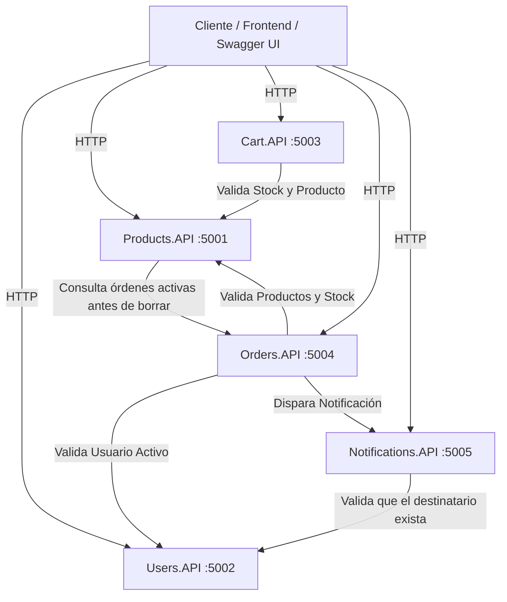
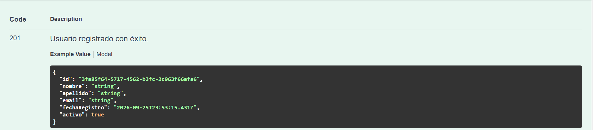
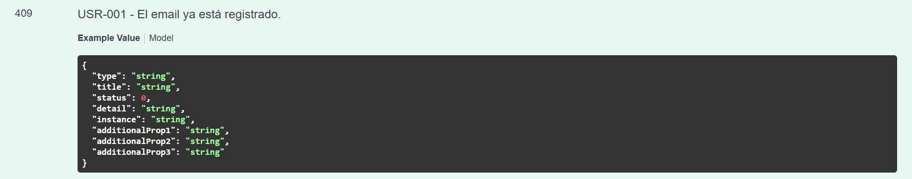
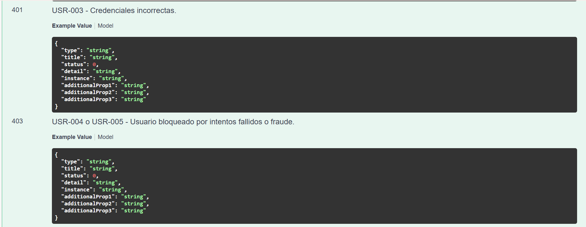

# 🛒 Sistema de E-Commerce - Microservicios .NET Core

Trabajo Práctico **Arquitectura y Diseño de Software**.  
Desarrollo de una plataforma de comercio electrónico modular basada en microservicios REST con **C# y .NET Core 10**, documentada con **Swagger / OpenAPI**, con logs estructurados en **Serilog**, trazabilidad mediante **Correlation ID** y manejo global de errores con **IExceptionHandler**.

---

## 👥 Integrantes del Grupo 8
- **Franco Martin Eusebio** (`Users.API`, `Cart.API`)
- **Rodrigo Perez Suzuki** (`Products.API`, `Notifications.API`)
- **Rocío Brunaga** (`Orders.API`)

---

## 🏗️ Arquitectura General del Sistema

El sistema está dividido en **5 microservicios independientes**, cada uno con su propia persistencia en memoria, puerto de red y responsabilidad única:



---

## 🌐 Tabla de Puertos y Servicios

| Microservicio | Puerto HTTP | Swagger UI | Estado |
| :--- | :---: | :--- | :---: |
| **`Products.API`** | `5001` | [http://localhost:5001/swagger](http://localhost:5001/swagger) | ✅ Completado |
| **`Users.API`** | `5002` | [http://localhost:5002/swagger](http://localhost:5002/swagger) | ✅ Completado |
| **`Cart.API`** | `5003` | [http://localhost:5003/swagger](http://localhost:5003/swagger) | ✅ Completado |
| **`Orders.API`** | `5004` | `http://localhost:5004/swagger` | ⏳ Pendiente |
| **`Notifications.API`** | `5005` | [http://localhost:5005/swagger](http://localhost:5005/swagger) | ✅ Completado |

> ⚠️ Los puertos están fijados en el código: `Products.API` llama a `Orders.API` en el **5004** (para PRD-004) y `Notifications.API` llama a `Users.API` en el **5002**. Si se cambia un puerto, hay que actualizar también la sección `Servicios` del `appsettings.json` del servicio que lo llama.

---

## 📦 Microservicio `Products.API` (Catálogo de Productos)

> 💡 **¿Qué es este servicio?**  
> `Products.API` es el **catálogo y depósito** de la tienda online.  
> 1. Almacena la lista de productos disponibles con su nombre, descripción, precio, cantidad en stock y categoría.
> 2. Permite buscar productos por categoría o por palabras en su nombre.
> 3. Evita que se creen dos productos con el mismo nombre dentro de una misma categoría.
> 4. Protege los pedidos de los clientes: **no permite borrar un producto** si todavía hay órdenes de compra pendientes o confirmadas que lo incluyan.

### 📋 Funcionalidades y Endpoints de `Products.API`

- **`GET /api/products`**: Lista los productos con filtros opcionales por categoría (`?categoria=Electrónica`) o por nombre (`?nombre=notebook`).
- **`GET /api/products/{id}`**: Obtiene el detalle de un producto por su identificador GUID (`200 OK` / `404 Not Found - PRD-001`).
- **`POST /api/products`**: Crea un nuevo producto validando que no exista otro con el mismo nombre en la misma categoría (`409 Conflict - PRD-003`).
- **`PUT /api/products/{id}`**: Actualiza los datos de un producto existente.
- **`DELETE /api/products/{id}`**: Elimina un producto previa consulta vía HTTP a `Orders.API` para verificar que no tenga órdenes activas (`409 Conflict - PRD-004`).

### 🚨 Catálogo de Errores de `Products.API`

| Código | Código HTTP | Mensaje de Error | Motivo / Cuándo ocurre |
| :---: | :---: | :--- | :--- |
| **`PRD-001`** | `404 Not Found` | *Producto no encontrado.* | El ID consultado no existe en el catálogo. |
| **`PRD-002`** | `400 Bad Request` | *Los datos del producto son inválidos.* | Faltan campos obligatorios o precio/stock inválidos. |
| **`PRD-003`** | `409 Conflict` | *Ya existe un producto con ese nombre en la categoría '{categoria}'.* | Intento de crear un duplicado en la misma categoría. |
| **`PRD-004`** | `409 Conflict` | *El producto tiene órdenes activas y no puede eliminarse.* | Hay órdenes en estado `Pendiente` o `Confirmada` con este producto. |
| **`PRD-005`** | `500 Internal Server Error` | *Error interno al procesar el producto.* | Error no controlado en el servidor. |

---

## 👤 Microservicio `Users.API` (Autenticación y Seguridad)

> 💡 **¿Qué es este servicio?**  
> `Users.API` es la **oficina de recepción y seguridad** de la tienda online.  
> 1. Cuando una persona nueva quiere comprar, va a la recepción a registrarse con su nombre, correo y contraseña.
> 2. La recepción guarda la contraseña bajo una caja fuerte codificada (hashing con BCrypt) para que **nadie** pueda ver la clave real.
> 3. Cuando el cliente vuelve a ingresar (login), la recepción valida que el correo y la contraseña coincidan.
> 4. Si una persona intenta adivinar una contraseña y **se equivoca 3 veces seguidas**, la recepción bloquea la cuenta de inmediato para proteger al usuario.

### 📋 Funcionalidades y Endpoints de `Users.API`

- **`POST /api/users/register`**: Registra un nuevo usuario con contraseña hasheada y validación de email único (`409 Conflict - USR-001`).
- **`POST /api/users/login`**: Autenticación con verificación de credenciales (`401 Unauthorized - USR-003`), bloqueo tras 3 intentos (`403 Forbidden - USR-004`) o fraude (`403 Forbidden - USR-005`).
- **`GET /api/users/{id}`**: Obtiene el usuario por GUID (`404 Not Found - USR-007`). Lo usan `Orders.API` para validar el comprador y `Notifications.API` para validar el destinatario.
- **`GET /api/users`**: Lista todos los usuarios registrados.

### 🚨 Catálogo de Errores de `Users.API`

| Código | Código HTTP | Mensaje de Error | Motivo / Cuándo ocurre |
| :---: | :---: | :--- | :--- |
| **`USR-001`** | `409 Conflict` | *El email '{email}' ya está registrado.* | Intento de registrar un email ya existente. |
| **`USR-002`** | `400 Bad Request` | *Los datos del usuario son inválidos.* | Faltan campos requeridos o formato inválido. |
| **`USR-003`** | `401 Unauthorized` | *Credenciales incorrectas.* | Email o contraseña erróneos. |
| **`USR-004`** | `403 Forbidden` | *Su cuenta fue bloqueada por superar el máximo de intentos fallidos.* | 3 intentos fallidos consecutivos (o usuario precargado `bloqueado@email.com`). |
| **`USR-005`** | `403 Forbidden` | *Su cuenta fue suspendida por razones de seguridad.* | Usuario bloqueado por fraude (usuario precargado `fraude@email.com`). |
| **`USR-006`** | `500 Internal Server Error` | *Error interno al procesar el usuario.* | Error no controlado en el servidor. |
| **`USR-007`** | `404 Not Found` | *Usuario con ID '{id}' no encontrado.* | Se busca un usuario con un GUID inexistente. |

> ℹ️ `USR-007` no está en el catálogo de la consigna (que llega hasta `USR-006`). Se agregó para el endpoint `GET /api/users/{id}`, que necesitan los otros servicios.

---

## 🛒 Microservicio `Cart.API` (Carrito de Compras)

> 💡 **¿Qué es este servicio?**
> `Cart.API` es el **changuito** de la tienda online.
> 1. Cada cliente tiene su propio carrito identificado por su ID de usuario.
> 2. Antes de agregar o actualizar un producto en el carrito, le pregunta a `Products.API` si ese producto existe y si tiene suficiente stock disponible.
> 3. Si el producto no existe (`CRT-002`) o el stock no alcanza (`CRT-003`), lo rechaza con un mensaje de error claro.
> 4. El cliente puede vaciar el carrito completo de un solo golpe o sacar un producto individual.

### 📋 Funcionalidades y Endpoints de `Cart.API`

#### 1. Ver el carrito (`GET /api/cart/{userId}`)
- **Qué hace:** Devuelve la lista de productos y cantidades que el usuario tiene en su carrito.
- **Códigos de respuesta:**
  - `200 OK`: Lista de ítems del carrito.
  - `404 Not Found`: El usuario no tiene carrito activo (`CRT-001`).

#### 2. Agregar producto al carrito (`POST /api/cart/{userId}/items`)
- **Qué hace:** Agrega un producto al carrito. Si el carrito no existe, lo crea. Si el producto ya estaba en el carrito, suma las cantidades.
- **Validaciones HTTP contra `Products.API`:**
  - Verifica que el producto exista (`CRT-002`).
  - Verifica que haya stock suficiente (`CRT-003`).
- **Códigos de respuesta:**
  - `204 No Content`: Ítem agregado correctamente.
  - `400 Bad Request`: Cantidad inválida (`CRT-004`).
  - `404 Not Found`: El producto no existe en el catálogo (`CRT-002`).
  - `422 Unprocessable Entity`: Stock insuficiente (`CRT-003`).

#### 3. Actualizar cantidad (`PUT /api/cart/{userId}/items/{productId}`)
- **Qué hace:** Cambia la cantidad de un producto ya existente en el carrito, re-validando stock en `Products.API`.
- **Códigos de respuesta:**
  - `204 No Content`: Actualizado correctamente.
  - `404 Not Found`: El carrito o el ítem no existen (`CRT-001` / `CRT-002`).
  - `422 Unprocessable Entity`: Stock insuficiente (`CRT-003`).

#### 4. Eliminar un producto del carrito (`DELETE /api/cart/{userId}/items/{productId}`)
- **Qué hace:** Quita un producto específico del carrito.
- **Códigos de respuesta:**
  - `204 No Content`: Eliminado correctamente.
  - `404 Not Found`: El carrito o el ítem no existen (`CRT-001` / `CRT-002`).

#### 5. Vaciar el carrito (`DELETE /api/cart/{userId}`)
- **Qué hace:** Elimina el carrito completo del usuario.
- **Códigos de respuesta:**
  - `204 No Content`: Carrito vaciado.
  - `404 Not Found`: El usuario no tiene carrito activo (`CRT-001`).

### 🚨 Catálogo de Errores de `Cart.API`

| Código | Código HTTP | Mensaje de Error | Motivo / Cuándo ocurre |
| :---: | :---: | :--- | :--- |
| **`CRT-001`** | `404 Not Found` | *El usuario '{id}' no tiene un carrito activo.* | Se consulta o modifica el carrito de un usuario que no tiene uno. |
| **`CRT-002`** | `404 Not Found` | *El producto '{id}' no existe en el catálogo.* | `Products.API` devuelve 404 para ese `productoId`. |
| **`CRT-003`** | `422 Unprocessable Entity` | *Stock insuficiente para el producto '{id}'.* | La cantidad solicitada supera el stock disponible en `Products.API`. |
| **`CRT-004`** | `400 Bad Request` | *La cantidad debe ser mayor a 0.* | Se envía una cantidad menor o igual a 0. |
| **`CRT-005`** | `500 Internal Server Error` | *Error interno al procesar el carrito.* | Error no controlado en el servidor. |

> ⚠️ **Para probar `Cart.API`** necesitás que `Products.API` esté corriendo en `http://localhost:5001`. Si no está levantado, los POST y PUT devolverán error de conexión.

---

## 🔔 Microservicio `Notifications.API` (Notificaciones)

> 💡 **¿Qué es este servicio?**  
> `Notifications.API` es el **correo interno** de la tienda online.  
> 1. Cuando otro servicio (o una persona desde Swagger) quiere avisarle algo a un cliente, le pide a este servicio que le mande un mensaje.
> 2. Antes de mandarlo, le pregunta a `Users.API` si ese cliente existe. Si no existe, no lo manda.
> 3. El mensaje puede ir por **Email**, **Push** o **SMS**. El envío es **simulado**: no se conecta con ningún proveedor real, solo lo registra como "Enviada".
> 4. Guarda todas las notificaciones, así se puede consultar el historial de cada cliente.

### 📋 Funcionalidades y Endpoints de `Notifications.API`

- **`POST /api/notifications/send`**: Registra una notificación y simula su envío. Valida el destinatario contra `Users.API` (`404 Not Found - NTF-001`) y que el tipo sea `Email`, `Push` o `SMS` (`400 Bad Request - NTF-002`). Responde `201 Created` con estado `Enviada`.
- **`GET /api/notifications/{userId}`**: Lista las notificaciones de un usuario (`404 Not Found - NTF-003` si no tiene ninguna).

Viene precargada una notificación para **María** (`a1b2c3d4-0000-0000-0000-111122223333`, el usuario de ejemplo de `Users.API`), así el `GET` responde algo desde el primer momento.

### 🚨 Catálogo de Errores de `Notifications.API`

| Código | Código HTTP | Mensaje de Error | Motivo / Cuándo ocurre |
| :---: | :---: | :--- | :--- |
| **`NTF-001`** | `404 Not Found` | *El usuario destinatario no fue encontrado.* | `Users.API` responde 404 para ese `usuarioId`. |
| **`NTF-002`** | `400 Bad Request` | *Los datos de la notificación son inválidos.* | Falta `usuarioId` o `mensaje`, el mensaje supera 500 caracteres o el tipo no es `Email`, `Push` ni `SMS`. |
| **`NTF-003`** | `404 Not Found` | *No se encontraron notificaciones para el usuario.* | El usuario no tiene notificaciones registradas. |
| **`NTF-004`** | `500 Internal Server Error` | *Error interno al procesar la notificación.* | Error no controlado, o `Users.API` no está levantado y no se puede validar el destinatario. |

---

## 📸 Evidencias de Funcionamiento (Swagger UI)

### 1. Registro Exitoso de un Usuario (`201 Created`)


---

### 2. Error por Email Duplicado (`409 Conflict - USR-001`)


---

### 3. Errores de Autenticación y Bloqueo de Cuenta (`401 USR-003` / `403 USR-004`)


---

## 🚀 Cómo Ejecutar los Microservicios

### 1. Requisitos Previos
- Tener instalado [.NET SDK 10.0](https://dotnet.microsoft.com/download/dotnet/10.0).

### 2. Compilar Toda la Solución
```powershell
dotnet build
```

### 3. Ejecutar `Products.API` (Puerto 5001)
```powershell
dotnet run --project src/Products.API/Products.API.csproj
```
👉 Swagger UI: [http://localhost:5001/swagger](http://localhost:5001/swagger)  
👉 Health Checks: [http://localhost:5001/health](http://localhost:5001/health)

### 4. Ejecutar `Users.API` (Puerto 5002)
```powershell
dotnet run --project src/Users.API/Users.API.csproj
```
👉 Swagger UI: [http://localhost:5002/swagger](http://localhost:5002/swagger)  
👉 Health Checks: [http://localhost:5002/health](http://localhost:5002/health)

### 5. Ejecutar `Cart.API` (Puerto 5003)
> ⚠️ Necesita que `Products.API` esté levantado para validar stock y existencia de productos.

```powershell
dotnet run --project src/Cart.API/Cart.API.csproj
```
👉 Swagger UI: [http://localhost:5003/swagger](http://localhost:5003/swagger)
👉 Health Checks: [http://localhost:5003/health](http://localhost:5003/health)

### 6. Ejecutar `Notifications.API` (Puerto 5005)
> ⚠️ Necesita que `Users.API` esté levantado al mismo tiempo para poder validar el destinatario.

```powershell
dotnet run --project src/Notifications.API/Notifications.API.csproj
```
👉 Swagger UI: [http://localhost:5005/swagger](http://localhost:5005/swagger)  
👉 Health Checks: [http://localhost:5005/health](http://localhost:5005/health)

### 💡 Levantar varios servicios a la vez desde Visual Studio
Clic derecho en la solución → **Configure Startup Projects** → **Multiple startup projects** → poner en **Start** los servicios que se quieran levantar (por ejemplo `Users.API` y `Notifications.API`).

---

## 📂 Estructura Arquitectónica Homogénea

Todos los microservicios comparten la misma arquitectura limpia y modular requerida por la cátedra:

```
src/{Servicio}.API/
├── Controllers/            # Controladores REST documentados con XML Comments
├── Models/                 # Entidades del dominio (Product, User, Notification)
├── DTOs/                   # Request, Response y ErrorResponse estructurado
├── Services/               # Lógica de negocio (IProductService, IUserService, INotificationService)
├── Data/                   # Repositorios en memoria con datos precargados
├── Exceptions/             # Excepciones tipadas de negocio (NotFound, Conflict, etc.)
├── ExceptionHandlers/      # Handlers individuales implementando IExceptionHandler
├── Middleware/             # Middleware de trazabilidad de CorrelationId
├── Common/                 # Catálogo de códigos de error y formateador de Health Checks
├── logs/                   # Archivos diarios de logs JSON estructurados (Serilog)
└── Program.cs              # Inicialización de Serilog, Swagger, middlewares y health checks
```
